# Prism – liquid glass phone shop

A five-page concept storefront for a small phone studio, built around a hand-made **liquid glass** effect in the spirit of iOS 26. Every glass surface bends the background behind it like a drop of water. Pure HTML, CSS and JavaScript: no frameworks, no build step.

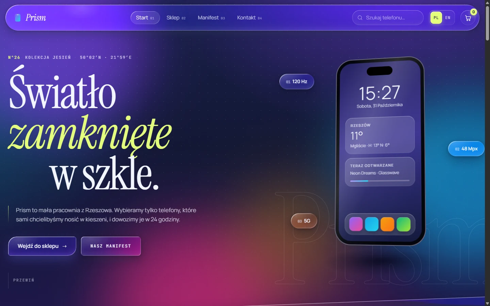

## Features

- **Liquid glass that refracts.** Glass elements do more than blur: each one gets its own displacement map, so the edges bend the content underneath while the centre stays clear.
- **3D phones in CSS.** Layered phone models (front, back with cameras, a sliced metal rim) that follow the cursor, rotate on scroll and can be dragged a full 360° on the product page.
- **Scroll-driven storytelling.** A pinned phone turns as you scroll through three chapters (display, camera, battery), and its screen changes with each one.
- **Model ring.** A full-width 3D carousel of all six phones. Drag it, use the arrows or let it spin by itself.
- **Working shop basics.** Live search, brand filters, price sorting, colour and storage options with price updates, and a cart drawer saved in `localStorage` across pages.
- **PL / EN.** A language switch in the header translates static copy, catalogue data, prices (`5 999 zł` / `PLN 5,999`), dates and messages.
- **Editorial details.** Headlines that rise word by word, film grain, outlined ghost type, glass marquees, a curtain transition between pages and a small glass lens that trails the mouse cursor.
- **Accessible motion.** `prefers-reduced-motion` turns animations off, and the custom cursor appears only for mouse pointers.

## Screenshots

| | |
|---|---|
| 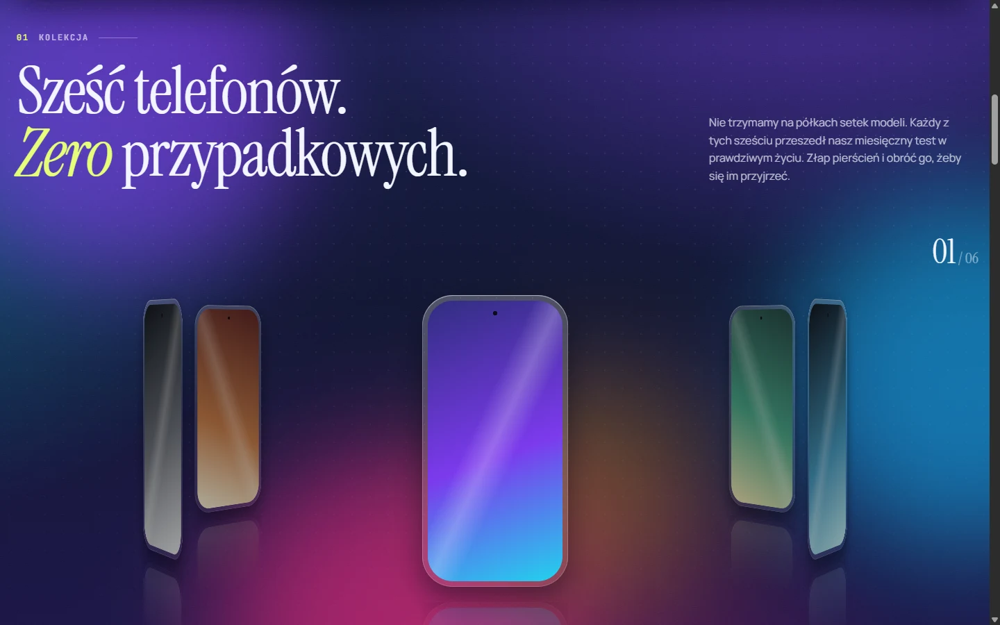 | 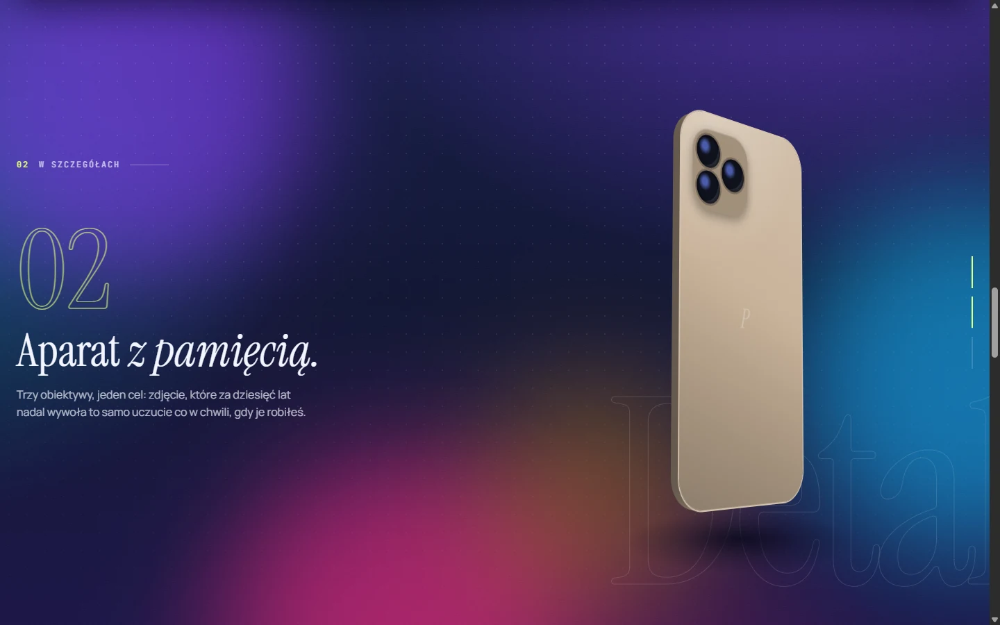 |
| **Model ring:** drag to spin all six phones | **Chapters:** the pinned phone turns as you scroll |
| 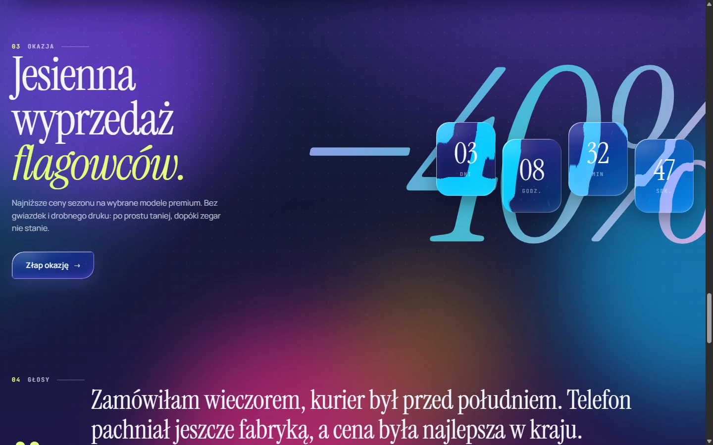 | 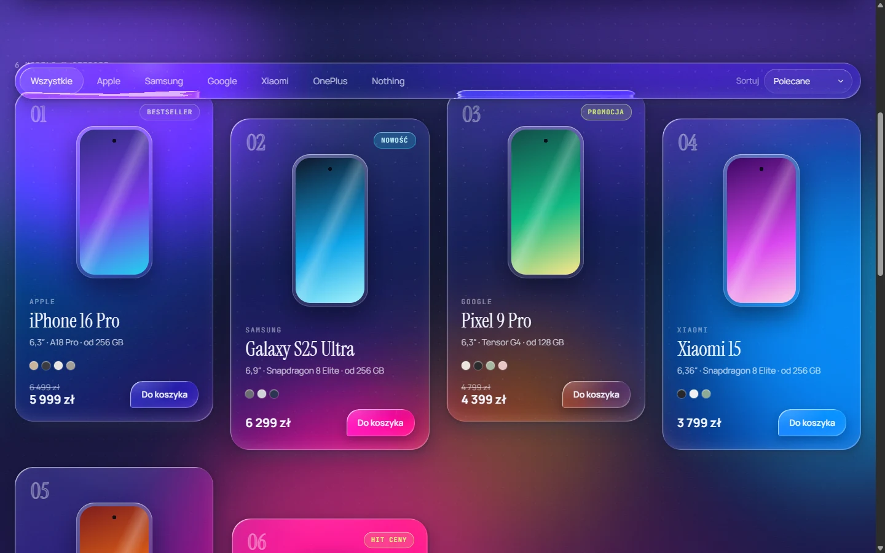 |
| **Sale:** glass countdown refracting a giant −40% | **Shop:** live search, brand filters, staggered cards |
| 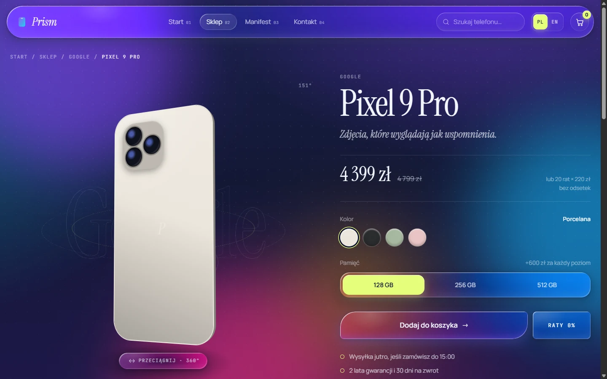 | 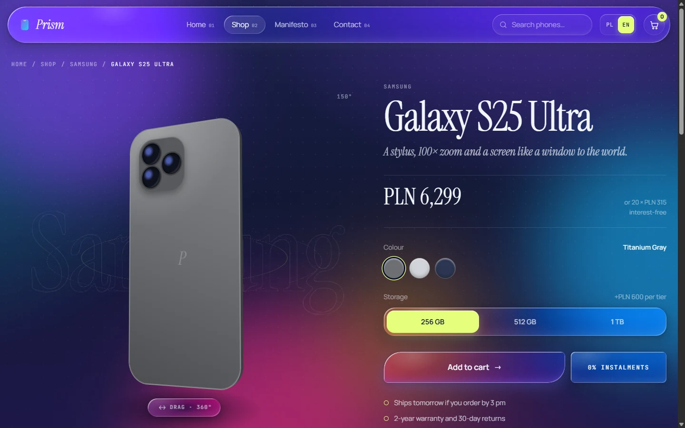 |
| **Product:** 360° viewer, colours, storage | **English version:** one click in the header |
| 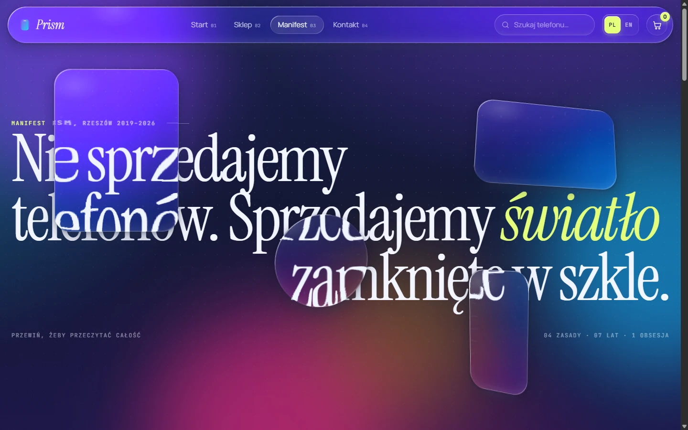 | 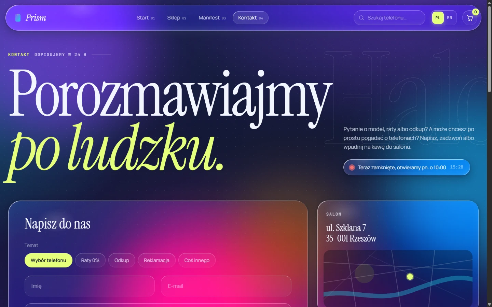 |
| **Manifesto:** 3D glass panes bending the headline | **Contact:** live open/closed status and a form |

<p align="center">
  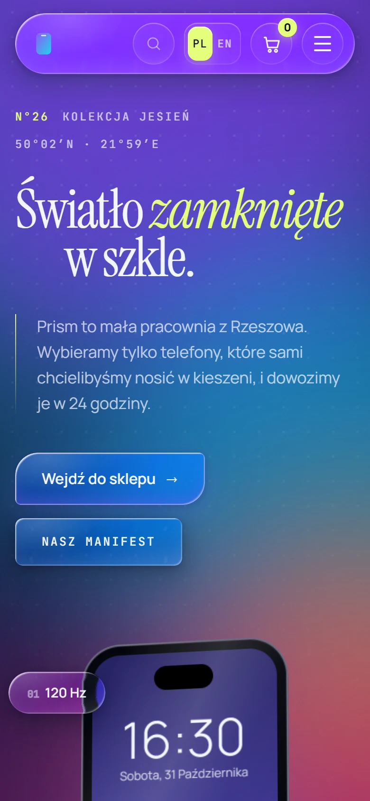
  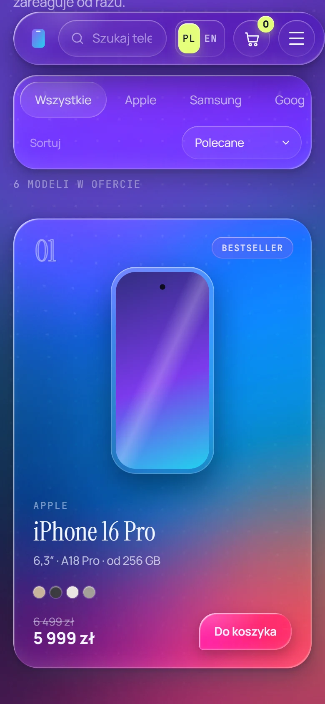
  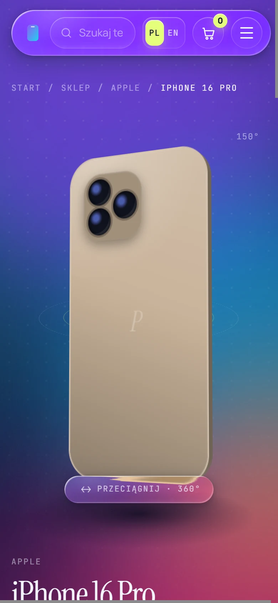
</p>

## Running it

There is nothing to install. Open `index.html` in a browser, or serve the folder if you prefer a local URL:

```bash
npx serve .
```

Fonts (Instrument Serif, Manrope, JetBrains Mono) load from Google Fonts. Offline, the page falls back to system fonts.

### Browser support

The full refraction effect needs SVG filters on `backdrop-filter`, which currently works only in **Chromium-based browsers** (Chrome, Edge, Opera, Arc). Firefox and Safari get a clean frosted-glass fallback, and everything else works the same.

## How the liquid glass works

Each `.glass` element is made of three layers:

| Layer | Role |
|---|---|
| `::before` | Refraction: `backdrop-filter` passed through an SVG `feDisplacementMap` |
| `::after` | Tint and a light rim along the edge |
| content | Sits on top, in normal flow |

On load, `script.js` generates a **displacement map for every glass element** on a `<canvas>`, sized to that element. The map is neutral in the middle and pushes the sampling inward towards the rounded edges (a superellipse profile), which makes the border bend the background like the rim of a water drop. A `ResizeObserver` rebuilds the map when an element changes size.

Shape and look are controlled with custom properties:

```css
.my-panel {
  --lg-r: 24px 6px 24px 6px; /* up to four radii, like border-radius */
  --lg-tint: rgba(139, 92, 246, .12);
  --lg-blur: 0px;
}
```

> **Gotcha:** no ancestor of a glass element may use `opacity < 1`, `filter` or `mask`. Each of these creates a new backdrop root and the glass loses the page behind it. This is why every entrance animation in the project uses `transform` only.

## Project structure

```
index.html      Home: hero, model ring, chapters, sale, reviews
sklep.html      Shop: search, filters, sorting
produkt.html    Product page (produkt.html?id=pixel-9-pro)
manifest.html   About: manifesto, principles, timeline, numbers
kontakt.html    Contact: form, studio status, FAQ
styles.css      All styles, with the glass core at the top
script.js       Interactions, 3D phones, cart and glass lens generation
data.js         Product catalogue (+ English text overrides)
i18n.js         English dictionary and language detection
```

### Adding a phone

Add an entry to `window.PRISM_PRODUCTS` in `data.js` (id, brand, name, price, colours, storage, specs). Optionally add its English tagline and colour names to `window.PRISM_PRODUCTS_EN`. The shop, product page, ring and cart pick it up automatically.

### Editing copy

Polish text lives directly in the HTML. Elements carrying a `data-i18n="key"` attribute get their English version from `i18n.js`. When you change a Polish sentence, update the same key in `i18n.js`.

---

Prism is a demo project. The shop, products, address and phone number are fictional, and checkout is intentionally not implemented.
